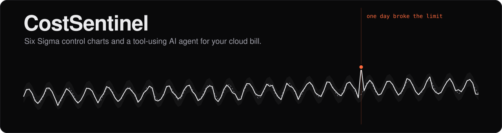
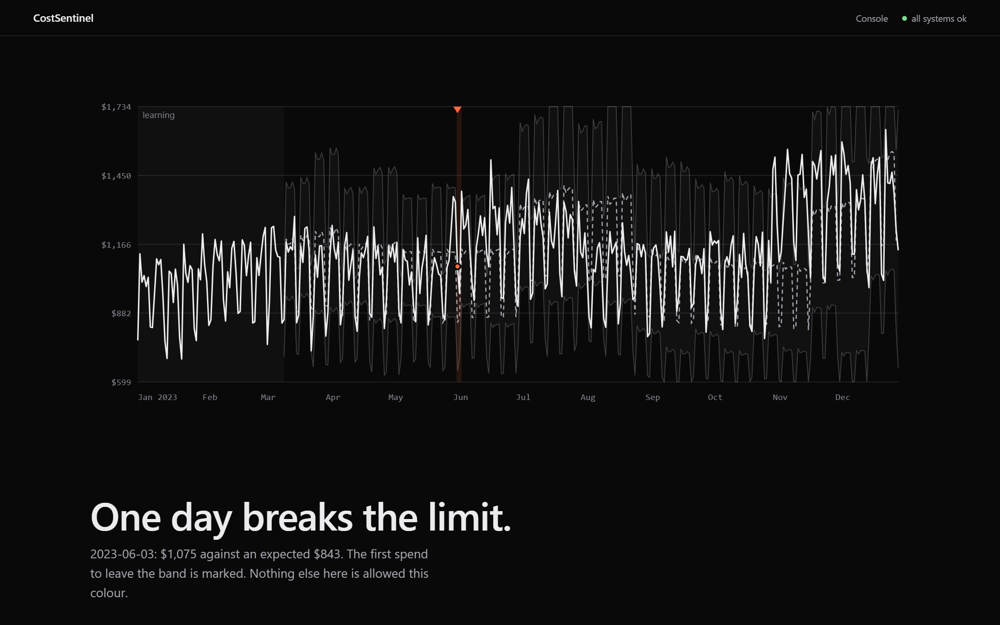
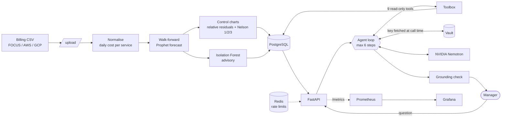
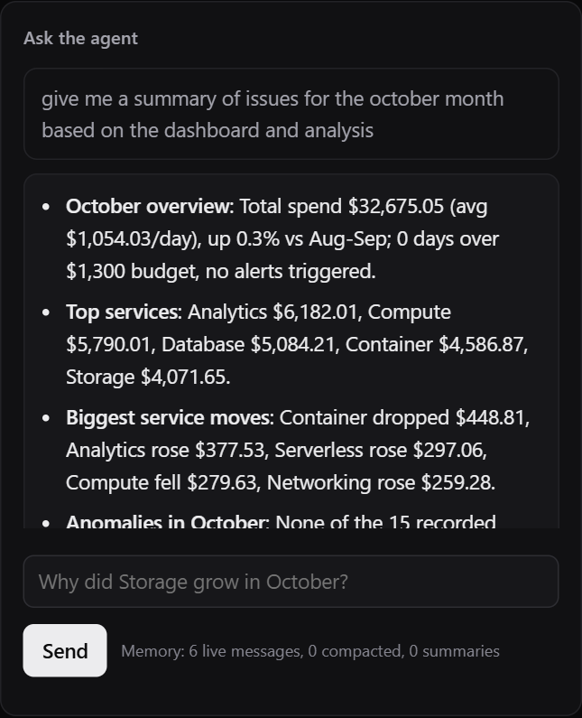
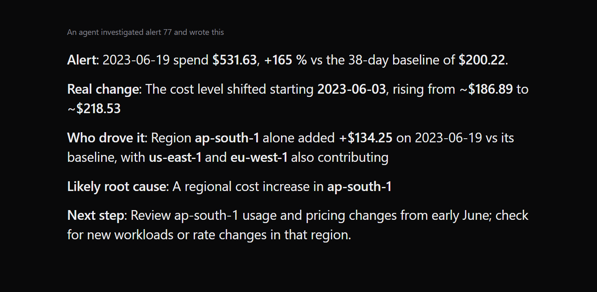
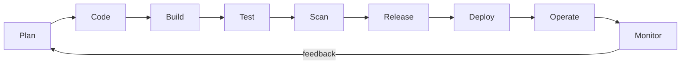
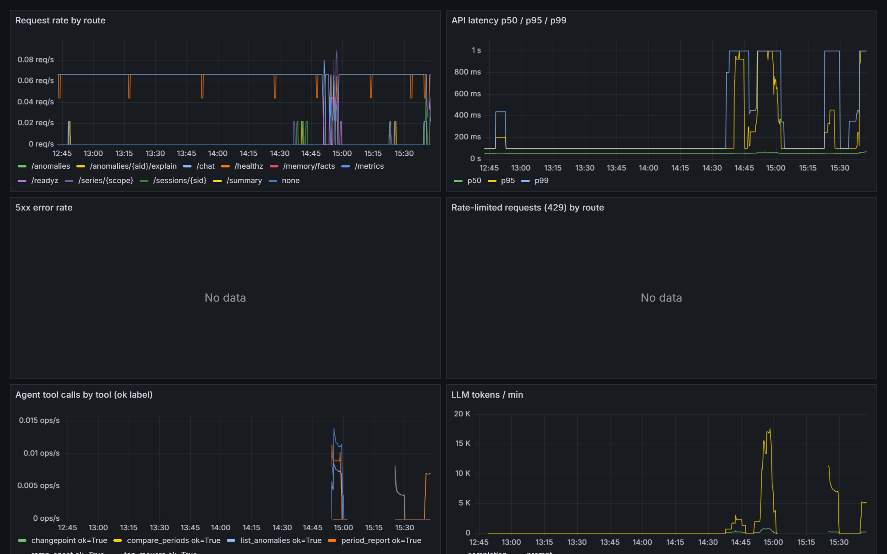

<div align="center">



<br>

[](https://github.com/Anakintano/cloud-costsentinel/actions/workflows/ci.yml)


**Upload a cloud billing export. Get a forecast, statistical alerts with a known false-alarm rate,<br>and an AI agent that explains each one in plain English for people who don't read control charts.**

[The problem](#-the-problem) · [STAR summary](#-summary-star) · [Architecture](#-architecture) · [Agentic ML](#-agentic-ml) · [DevOps lifecycle](#-devops-lifecycle) · [Results](#-measured-results) · [Run it](#-run-it)

<br>



<sub>The only orange on the page marks the day spend left the control band.</sub>

</div>

<br>

## 🔥 The problem

Cloud bills fail quietly. Four ways it goes wrong:

| | Failure | Why a fixed budget alert doesn't help |
|---|---|---|
| 💥 | **Runaway jobs**: a loop or retry storm burns money over a weekend | You find out when the invoice arrives |
| 🐌 | **Slow leaks**: spend creeps 1-4% a day | No single day looks wrong |
| 📢 | **Noise**: weekday/weekend swings trip thresholds | Teams learn to ignore alerts |
| 🤷 | **No explanation**: "cost is high" | A manager needs *which service, since when, and what to do* |

### It happens to real teams

| Case | What happened | Lesson |
|---|---|---|
| [Rogue Lambda, ~$10,000](https://dev.to/chrlie/the-bug-that-cost-us-10000-a-postmortem-on-a-rogue-aws-lambda-function-2m28) | A serverless function got stuck in a self-triggering loop over a weekend. The team found it from an unusually high bill, then CloudWatch showed millions of executions. | Found after the money was gone. |
| [NAT Gateway, ~$1,600 per spike](https://www.doit.com/blog/monitoring-unexpected-traffic-spikes-in-aws-nat-gateways-a-cost-effective-serverless-solution) | A customer saw random 35 TB spikes through a NAT Gateway, each adding about $1,600, with no clear cause. | Intermittent spikes hide inside a normal-looking month. |
| [Lambda + Step Functions + Logs (FinOps Foundation)](https://www.finops.org/assets/beware-of-runaway-aws-lambda-costs/) | An SQS-triggered function reprocessed bad messages while downstream services added spend ("thousands of dollars in a day"). | The cause only showed when several services were compared together. |

<sub>These are public engineering write-ups. Reddit threads were not reachable from the research tool, so none are cited.</sub>

<br>

## ⭐ Summary (STAR)

<table>
<tr><td width="130"><b>Situation</b></td><td>Cloud spend has a weekly rhythm, noise and slow drift. Fixed-threshold alerts either fire constantly or miss leaks, and managers can't read control charts or raw tool output.</td></tr>
<tr><td><b>Task</b></td><td>Detect real changes in spend at a known false-alarm rate, then explain each one in plain words. Every figure the agent states must come from a computed result.</td></tr>
<tr><td><b>Action</b></td><td>
Normalised FOCUS/AWS/GCP billing CSVs and ran a <b>walk-forward Prophet forecast</b> (each day predicted by a model that had not seen it).<br>
Drew <b>Six Sigma control charts</b> with Nelson rules on the forecast errors.<br>
Built a <b>tool-using LLM agent</b> (NVIDIA Nemotron) with read-only statistics tools and a grounding check that rejects unsupported numbers.<br>
Shipped it with <b>containers, a CI security gate, Kubernetes, Vault, rate limiting and monitoring</b>.
</td></tr>
<tr><td><b>Result</b></td><td>
0.41% false alarms on calm days · a real +28% shift flagged on its first day · slow leaks caught in 11-17 days · agent root-cause right in 8 of 9 live trials (lenient rubric) · 49 tests · image scan clean. <a href="#-measured-results">Details and limits below.</a>
</td></tr>
</table>

<br>

## 🧭 Architecture



<br>

## 🤖 Agentic ML

<table>
<tr>
<td width="50%"></td>
<td width="50%"></td>
</tr>
<tr>
<td><sub><b>A non-technical question.</b> The agent calls <code>period_report</code> and <code>list_anomalies</code> itself, then answers in bullets. Every figure matches the database.</sub></td>
<td><sub><b>An investigated alert.</b> Short labelled points, key figures in bold, ending in a next step.</sub></td>
</tr>
</table>

**Forecasting and detection**

- **Walk-forward Prophet:** refit every 28 days after a 42-day warm-up, so each day is judged by a model that hadn't seen it. A one-shot holdout let a +28% shift be absorbed into the trend.
- **Relative residuals:** errors are a share of expected spend. Limits are calibrated separately for early and late days of each block, because forecast error grows with horizon.
- **Nelson rules 1/2/3:** spike, 9-day shift, 6-day trend. Shift and trend alerts are capped at "low" severity unless the magnitude is large, since they fire about twice as often by chance.
- **Isolation Forest:** kept as an advisory multi-service signal. It showed no measurable gain over per-series charts.
- **Cpk vs budget:** a single capability number for "does spend regularly exceed the budget?"

**The agent**

- **Nine read-only tools:** `period_report`, `list_anomalies`, `get_series`, `chart_stats`, `top_movers`, `compare_periods`, `changepoint`, `ramp_onset`, `correlate`. Arguments are validated, and none of them writes or executes anything.
- **Bounded loop:** at most 6 steps and a token cap, then it must answer from what it has.
- **It knows your data:** every chat starts with a short dataset card (date range, services, budget, alert count), so it never asks the user to run a tool.
- **Grounding check:** every number and date in an answer must appear in a tool result. Ungrounded answers get one repair round.
- **No tool call, no numbers:** an answer with unverified figures and no tool call is discarded and tools are forced. Early on, the model invented October dollar figures and cited a tool it never called. This guard is why that can't reach a user.
- **Prompt-injection defence:** billing labels pass an allow-list before the model sees them. Tool output is treated as data, never as instructions.
- **Stateless API, durable memory:** Postgres holds messages, one rolling summary per session and user-written facts. Compaction at about 6k tokens never separates a tool call from its result.
- **Facts are human-only:** a poisoned tool result can't become a lasting "fact". Users mark an alert "expected" with a note and the agent sees it from then on.
- **Plain language:** 3-6 short bullets, key figure in bold, no statistics jargon.
- **Cost controls:** per-client rate limits plus a daily LLM-token budget.

<br>

## ♾️ DevOps lifecycle



| Stage | What | Where |
|---|---|---|
| **Plan** | Decisions and measured results kept in the repo | `README.md`, `docs/` |
| **Code** | FastAPI, pandas, Prophet, scikit-learn, SQLAlchemy | `backend/app/` |
| **Build** | Multi-stage Docker image; non-root (uid 10001); pip and build tools removed from the runtime | `backend/Dockerfile` |
| **Test** | 49 pytest tests, including live Redis and Vault integration; offline detection and agent evaluations | `backend/tests/`, `backend/scripts/eval_*.py` |
| **CI** | GitHub Actions: pytest with Redis and Vault service containers, buildx with layer cache, `helm lint` | `.github/workflows/ci.yml` |
| **Security** | Trivy (pinned container, not a third-party action): image scan plus repo scan for secrets and Kubernetes/Docker misconfiguration, failing on fixable HIGH/CRITICAL; Vault holds the LLM key; optional API-key auth | CI, `.trivyignore.yaml`, `app/secrets.py` |
| **Release** | Image pushed to GHCR on `main`, tagged by commit SHA | CI |
| **Deploy** | Docker Compose for local; Helm chart for Kubernetes (tested on Minikube) | `docker-compose.yml`, `deploy/helm/costsentinel/` |
| **Database changes** | Alembic migrations at startup, serialised with a Postgres advisory lock | `backend/alembic/` |
| **Operate** | `/healthz` and `/readyz` probes, memory limits, log rotation, DB-connect retry | compose, Helm values |
| **Monitor** | Prometheus metrics (requests, latency, LLM tokens, tool calls); provisioned Grafana dashboard | `deploy/prometheus/`, `deploy/grafana/` |
| **Feedback** | "Mark as expected" notes are pinned into the agent's context | `/anomalies/{id}/status` |

<div align="center">

<br><sub>The provisioned Grafana dashboard, showing request rate, p50/p95/p99 latency, agent tool calls by tool and LLM tokens per minute.</sub>
</div>

<details>
<summary><b>Run it on Kubernetes</b></summary>

```sh
minikube start
helm install cs deploy/helm/costsentinel
KEYFILE=path/to/file-with-your-nvidia-key RELEASE=cs sh scripts/seed_vault_k8s.sh   # in-cluster dev Vault
kubectl port-forward svc/cs-backend 8000:8000
```
The service is named `<release>-backend`.
</details>

<br>

## 📊 Measured results

Dataset: Kaggle `atharvgunjarge/cloud-cost-dataset`, 365 days, synthetic-looking, no anomaly labels. Injected faults were added to measure detection.

| Measure | Result |
|---|---|
| False alarms on calm days (rule 1) | **0.41%** of series-days (3-sigma theory: 0.27%) |
| Real +28% level shift (Nov 2023) | Flagged on its **first day** (z 4.5) |
| Single-service spike | Detected from about **3x** spend. 2x is lost in this data's noise. |
| Slow leak (1-4% per day) | First alert on day **+11 to +17** (cost 1.2-1.6x) |
| Shift and trend rules (2/3) | About 2x the false-alarm rate of rule 1, hence the severity cap |
| Isolation Forest | No demonstrated gain; advisory only |
| Agent, live (3 trials x 3 scenarios) | spike **2/3**, leak **3/3**, real Nov shift **3/3** |
| Agent cost | About 22-30k tokens and 15-45 s per investigation |
| Test suite | **49** passing, none skipped, with live Redis and Vault |
| Container image | Trivy: 0 HIGH/CRITICAL |

### Honest limits

- The agent score uses a **lenient rubric** (right service, onset date within tolerance, at least two distinct tools). Some replies still contain a wrong secondary claim (step vs ramp, rule semantics) or a leftover unverified figure. The table above was measured **before** the latest prompt changes and has not been re-run since.
- The Kaggle data is synthetic. A FinOps FOCUS sample had only about 30 usable days and is rejected by the 84-day minimum.
- The dev stack uses placeholders: Vault in dev mode (in-memory, re-seed after any recreate), a default Postgres password, Grafana `admin/admin`. There are no Kubernetes NetworkPolicies and no Terraform yet. The in-cluster dev Vault and Postgres pods are not read-only-rootfs hardened; those three Trivy findings are recorded as path-scoped exceptions in `.trivyignore.yaml` (the backend and Redis pods are hardened and not excepted).
- The UI has no API-key field, so with `REQUIRE_API_KEY=1` it can't call the API.

<br>

## 🚀 Run it

```sh
git clone https://github.com/Anakintano/cloud-costsentinel && cd cloud-costsentinel
docker compose up -d                                   # vault, redis, postgres, backend, prometheus, grafana
KEYFILE=path/to/file-with-your-nvidia-key sh scripts/seed_vault.sh   # key goes via stdin, never echoed
python backend/scripts/make_demo_csv.py demo.csv        # 160 days with injected faults
curl -F file=@demo.csv -F budget=1300 localhost:8000/upload
curl localhost:8000/anomalies
```

| | |
|---|---|
| **UI** | http://localhost:8000/ (served by the API, no build step) |
| **API docs** | http://localhost:8000/docs |
| **Grafana** | http://localhost:3000 (dashboard "CostSentinel API") |
| **Prometheus** | http://localhost:9090 |
| **Tests** | `cd backend && pip install -r requirements.txt -r requirements-dev.txt && python -m pytest -q` |

<details>
<summary><b>API endpoints</b></summary>

`GET /healthz` · `GET /readyz` · `GET /metrics` · `POST /upload` · `GET /anomalies` · `GET /series/{scope}` · `GET /summary` · `PUT /budget` · `POST /chat` · `POST /anomalies/{id}/explain` · `POST /anomalies/{id}/status` · `GET|POST /memory/facts` · `DELETE /memory/facts/{id}` · `GET|DELETE /sessions/{id}` · `POST /sessions/{id}/compact`
</details>

<details>
<summary><b>Repository layout</b></summary>

```
backend/app/        API, detection, forecast, agent, tools, memory, grounding, secrets, rate limits
backend/alembic/    database migrations
backend/ui/         single-file console (served by the API)
backend/tests/      49 tests
backend/scripts/    demo data generator and evaluation harnesses
deploy/helm/        Kubernetes chart
deploy/{prometheus,grafana}/
scripts/            Vault seeding (compose and Kubernetes)
.github/workflows/  CI
docs/               screenshots, evaluation output, UI brief
```
</details>

<div align="center"><sub>Built with FastAPI, Prophet, scikit-learn, PostgreSQL, Redis, Vault, Docker, Helm, Prometheus and Grafana.</sub></div>
